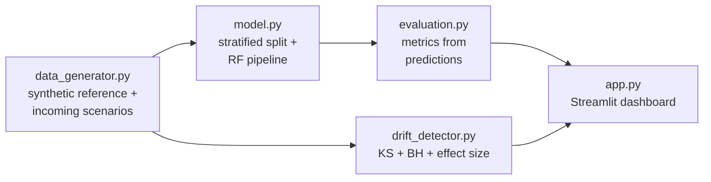

# Drift Detective

**An explainable ML model-monitoring dashboard (educational prototype).**

Drift Detective shows what happens to a supervised classifier when incoming data
drifts away from its training reference. It generates reproducible synthetic
server-monitoring data, trains a random-forest risk classifier, simulates normal /
moderate / severe drift, detects per-feature distribution changes with KS tests,
and compares labelled performance — in an interactive Streamlit dashboard.

> Synthetic data only. Distribution monitoring and performance evaluation are kept
> separate: drift does not automatically mean accuracy dropped. This is a learning
> project, not a production monitoring platform.

## Features

- Reproducible synthetic data (reference + 3 drift scenarios, seeded)
- RandomForest risk classifier with stratified split, no leakage
- Accuracy / precision / recall / F1 + confusion matrices, reference vs incoming
- Per-feature KS drift tests, BH correction, Cohen's d, transparent flag rule
- Plotly distribution overlays, feature importances, most-changed ranking
- pytest suite covering generator, model, detector, evaluation
- Runs locally on a laptop; no APIs, GPU, or cloud needed

## Architecture



## Tech stack

Python 3.11+ · NumPy · pandas · scikit-learn · SciPy · Streamlit · Plotly · pytest

## Project structure

```
drift-detective/
    app.py
    requirements.txt
    README.md
    .gitignore
    src/
        __init__.py
        data_generator.py
        model.py
        drift_detector.py
        evaluation.py
    tests/
        test_data_generator.py
        test_model.py
        test_drift_detector.py
        test_evaluation.py
    docs/
        methodology.md
        interview_guide.md
```

## Installation (Windows)

```powershell
cd drift-detective
python -m venv .venv
.venv\Scripts\Activate.ps1
pip install -r requirements.txt
```

Requires Python 3.11 or newer.

## Run the dashboard

```powershell
cd drift-detective
.venv\Scripts\Activate.ps1
streamlit run app.py
```

Then open the printed local URL (usually http://localhost:8501). Use the sidebar
to switch scenarios, adjust alpha, rows, and seed.

## Run the tests

```powershell
cd drift-detective
.venv\Scripts\Activate.ps1
pytest -v
```

## How it works (short)

- **Data:** five numeric features from documented Gaussians; `risk_label` from a
  fixed z-score rule (see `docs/methodology.md`). Normal / moderate / severe
  incoming scenarios shift selected feature means.
- **Model:** stratified 80/20 split, median-imputation + RandomForest(200 trees)
  pipeline fitted on train only.
- **Drift:** two-sample KS test per feature, Benjamini–Hochberg adjusted p-values,
  Cohen's d effect size. Flagged when `(adj_p < alpha and |d| ≥ 0.2) or |d| ≥ 0.5`.
- **Evaluation:** the frozen reference model is scored on labelled incoming data;
  the dashboard shows deltas next to the drift table.

## Interpreting results

- Start with the overall drift status, then read the per-feature table.
- A small adjusted p-value is evidence against "same distribution", not proof the
  model broke — confirm with the incoming accuracy panel.
- Large samples flag tiny shifts; the |d| ≥ 0.2 gate keeps flags meaningful.
- See `docs/methodology.md` for assumptions and `docs/interview_guide.md` for
  talking points.

## Limitations

- Synthetic independent Gaussians; no correlations, seasonality, or regimes.
- Fixed label rule: data drift only, not concept drift.
- Univariate KS tests; multivariate shifts can be missed.
- Incoming labels are a synthetic convenience — production labels lag or vanish.
- No retraining loop, alerting, or deployment concerns by design.

## Troubleshooting

| symptom | fix |
|---|---|
| `ModuleNotFoundError: src` | run from the `drift-detective/` folder |
| Streamlit won't start | check `.venv` is activated and requirements installed |
| Tests fail on import | same: activate `.venv`, `pip install -r requirements.txt` |
| Port 8501 busy | `streamlit run app.py --server.port 8502` |

## Future improvements

- Multivariate drift (MMD / PSI comparison), calibration tracking
- Concept-drift scenario with a changed label rule
- Optional retraining experiment, kept separate from the main comparison
- Public-dataset evaluation (kept separate from synthetic results)
